# What separates good maize harvests from bad ones? Evidence from 24,000 farms in Kenya

I analysed **23,674 maize farms** across **53 districts in Kenya** from 2016 to 2020 (One Acre Fund agronomic surveys) to see what separates high-yield harvests from low-yield ones. The typical farm harvests **1,186 kg per acre** (middle half: 789 to 1,663 kg/acre), but yields run from **0 kg/acre** (326 crop failures, 1.4%) to **4,100 kg/acre**.

Why do two farms in the same country, often in the same district, end up with wildly different harvests? This project walks through the data to separate real drivers from geographic illusions.

**Tools:** Python, pandas, seaborn, matplotlib, scipy, scikit-learn  
**Notebooks:** [`data_cleaning.ipynb`](data_cleaning.ipynb) · [`data_visualization_updated.ipynb`](data_visualization_updated.ipynb) · [`modelling.ipynb`](modelling.ipynb)

---

The main factors that separate high-yield farms from low-yield ones are **hybrid seed**, **field fertility**, and **DAP fertiliser**.

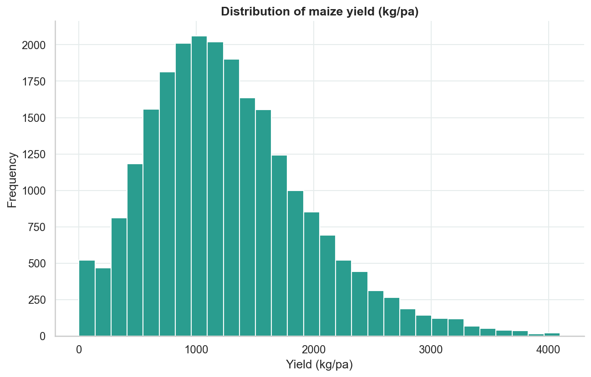

Most harvests cluster between 800 and 1,700 kg/acre, with a long right tail past 3,000 kg/acre and a small spike at zero (1.4% of farms) retained as genuine crop failures.

### The short answer

Comparing farms **within the same district and the same year** (so a fertile region or a good rainy season cannot take the credit), three factors stand out: **hybrid seed**, **field fertility**, and **DAP fertiliser**.

| Factor | Comparison | Consistency within district-years | Typical gap (kg/acre) |
|---|---|---|---:|
| Hybrid seed | Named hybrid vs. local only | 100% of 68 district-years | +373 |
| Field fertility | Better vs. worse than farmer's other fields | 96% of 26 district-years | +346 |
| DAP fertiliser | Used vs. not used | 95% of 60 district-years | +283 |
| Compost | Used vs. not used | 77% of 95 district-years | +124 |
| Drought | Reported vs. not | 75% of 64 district-years | −90 |
| Flood | Reported vs. not | 65% of 51 district-years | −64 |

A *district-year* is one district in one year. Comparing farms inside the same district-year keeps geography and good seasons from distorting the result.

## Why district and year matter first

Before looking at farming practices, I looked at **who was surveyed and when**. Sample size grew from 3,876 farms in 2016 to 6,190 in 2020, and coverage is heavily concentrated in western Kenya (Gem, Busia, and Alego each have over 1,000 farms, while some districts have fewer than 50). Crucially, the mix of districts shifts from year to year.

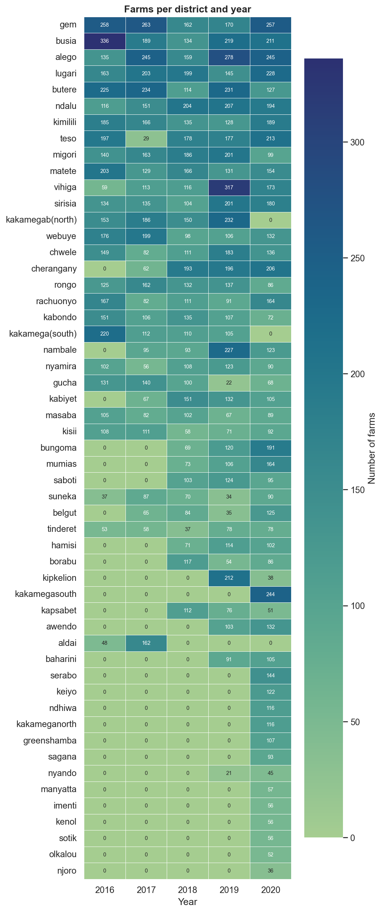

Overall yield changed across seasons. It peaked in 2017, then dipped in 2018–2019, and recovered slightly in 2020 partly because weather changed and partly because different districts entered the sample each year. Because both the weather and the mix of surveyed districts change each season, raw overall averages mix farming practices with year and location effects. To separate them, I compare farms within the same district and year.

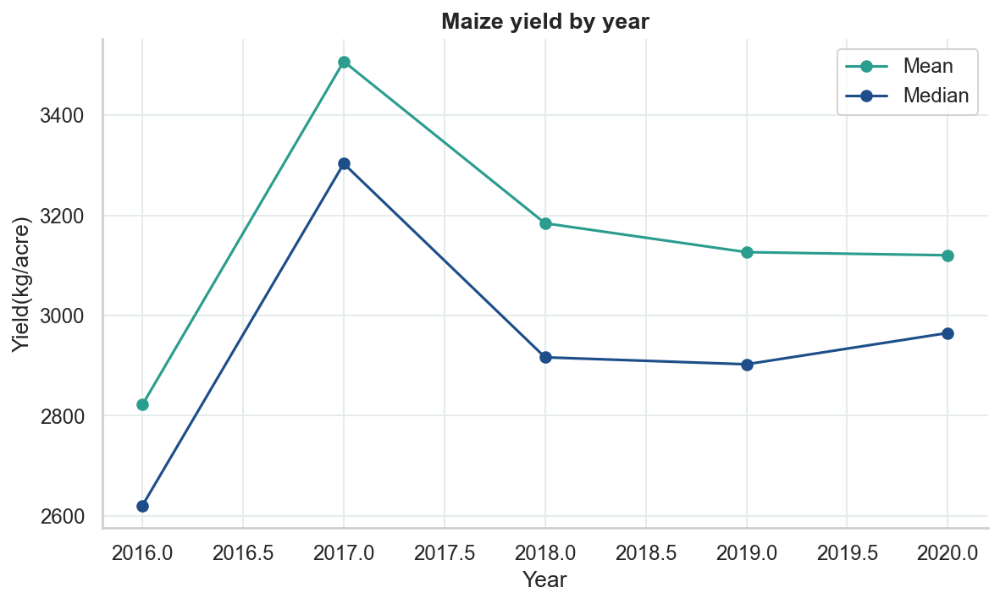

## Place explains less than you'd think

Across the 53 districts with at least 30 observations, median yields rise slightly from west to east and mostly sit between 700 and 1,750 kg/acre.

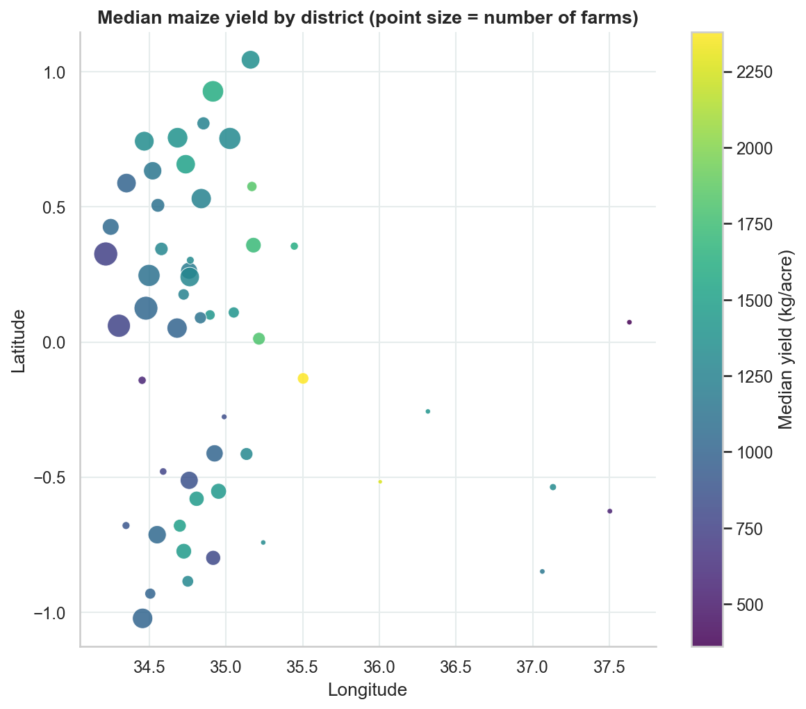

Yet **district explains only 18% of the variation in yield**. The other **82%** comes from differences between farms in the same district. On a farm-level map, high-yield and low-yield fields sit right next to each other.

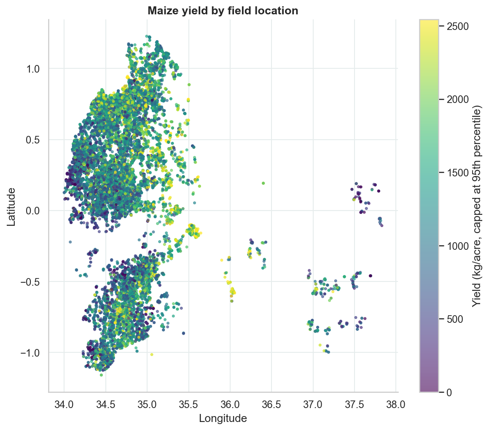

Plot size accounts for very little of that gap either — median yield changes only modestly across plot sizes.

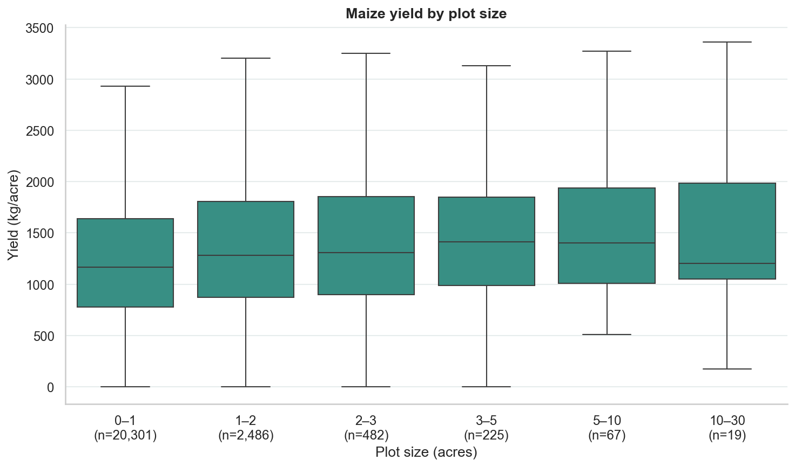

## What farmers do matters most

### Seed choice

Farmers who plant a named hybrid harvest a median **1,285 kg/acre**, compared with **776 kg/acre** for local seed alone (**+66%**). Hybrid beats local in **all 68 district-year comparisons** (+373 kg/acre median gap). Farms using hybrid seed and DAP reach **1,304 kg/acre**, **91% higher** than farms using local seed without DAP (684 kg/acre).

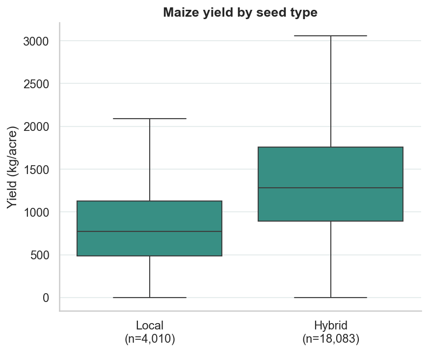

### Field fertility

Farmers rated each plot against their other fields (`worse`, `same`, or `better`). Plots rated `better` harvest **1,329 kg/acre** at the median versus **922 kg/acre** for `worse` (**+44%**, or **+346 kg/acre** across 96% of 26 district-years). Farmers on better plots use DAP (87% vs. 78%) and hybrid seed (86% vs. 73%) only slightly more often, so input use alone does not drive this gap.

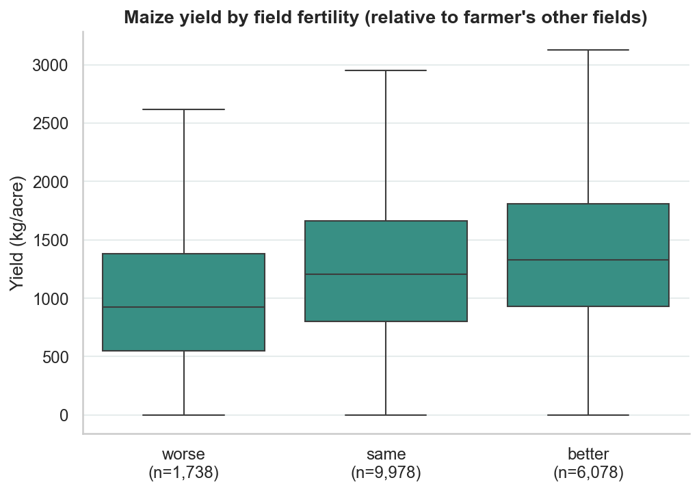

### DAP fertiliser

Farms that use DAP fertiliser yield **1,237 kg/acre** compared to **905 kg/acre** for those that don't (**+36.6%**). Too few farms apply urea or NPK to measure their effect.

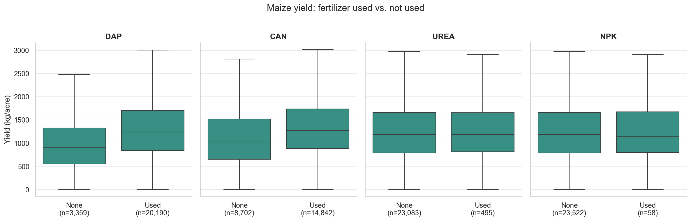

Out of the 29 districts with at least 30 farms on each side, DAP users out-yield non-users in **28 districts**; only Masaba shows a slight dip (−26 kg/acre, with just 31 non-DAP farms). When I compare farms within the same district and year, DAP still comes out ahead in **95% of 60 district-years** (median gain **+283 kg/acre**).

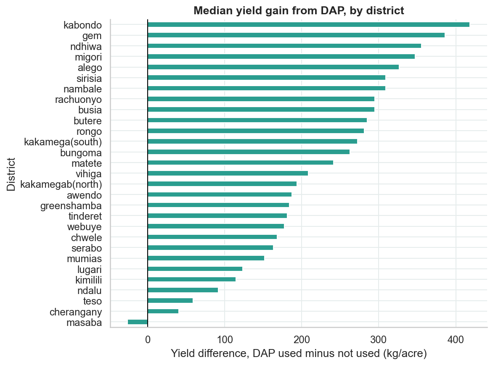

More DAP does not keep raising yield. Doses under 25 kg/acre add little over zero (969 vs. 899 kg/acre). Yield climbs through 25–40 kg/acre (1,171 kg/acre), peaks at **1,368 kg/acre** for **41–50 kg/acre** (roughly one 50 kg bag), and flattens past 50 kg/acre (1,330 kg/acre).

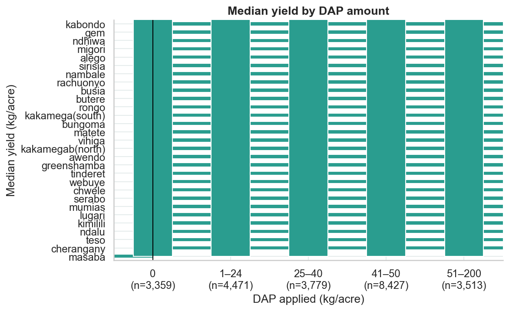

## Three results that changed inside district-years

### Drought

Pooled across all years, drought cuts median yield by **219 kg/acre** (1,244 down to 1,026 kg/acre).

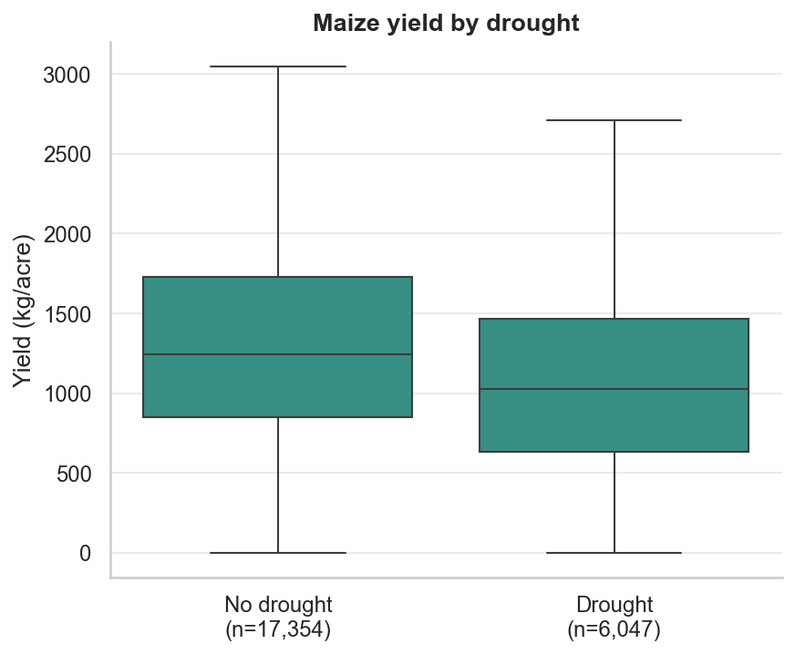

However, drought hit **50% of farms in 2016 and 2019** versus **1% in 2018**, and drought-prone districts yield less even in normal years. Inside the same district and year, the drought gap drops to **−90 kg/acre** (lower in 75% of 64 district-years). Drought also does not explain zero-yield crop failures, which appear in both groups.

### Compost

In the raw data, compost shows almost no difference (**1,202 vs. 1,216 kg/acre**).

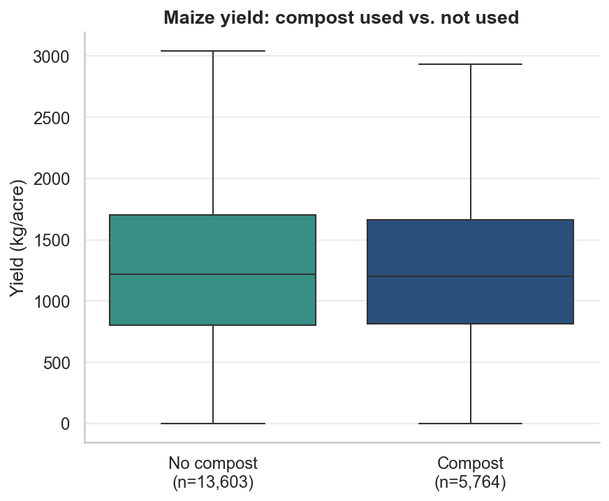

Inside district-years, farms using compost out-yield neighbours by **+124 kg/acre** (77% of 95 district-years). Across districts, the pattern flips: **districts that use more compost have lower median yields** (Spearman ρ = −0.53 across 53 districts), suggesting farmers apply compost more often where soils are poorer.

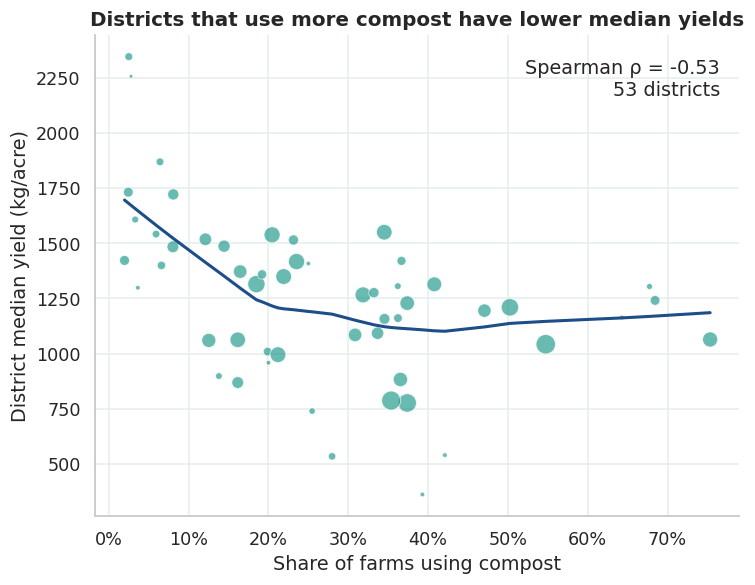

### Length of growing season

Raw medians climb steadily from **1,034 kg/acre** (≤120 days) to **1,467 kg/acre** (181+ days), a **+42%** jump.

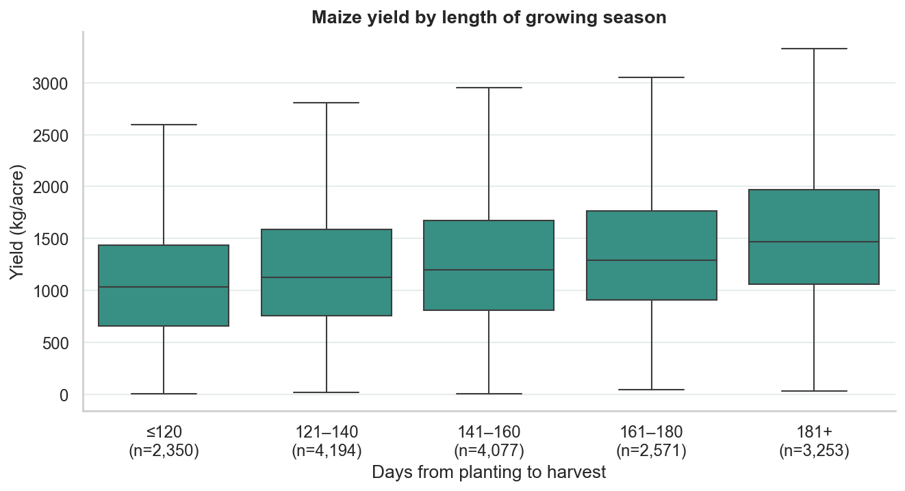

Inside district-years, that gap shrinks to **+20 kg/acre** (57% of 81 district-years). Longer seasons mostly mark cooler, higher-yielding highland districts rather than a direct benefit of more days in the field.

## Smaller findings

- **Weeding:** Farms that weed **twice** harvest **20–30% more** than farms that weed once (+179 kg/acre across 81% of 57 district-years). A third weeding adds nothing. *(I excluded the small zero-weeding group because its anomalously high median has no agronomic explanation.)*

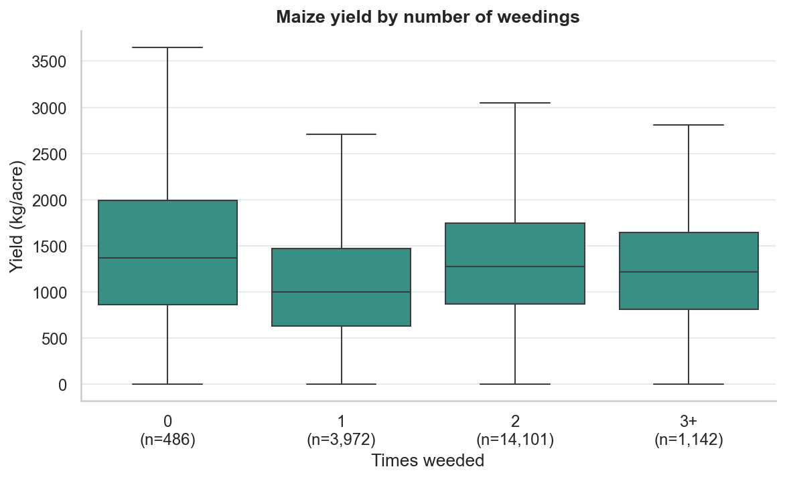

- **Cows:** Farms owning at least one cow harvest **11.1% more (+120 kg/acre)** across 81% of 134 district-years, with no extra gain from owning more cows.

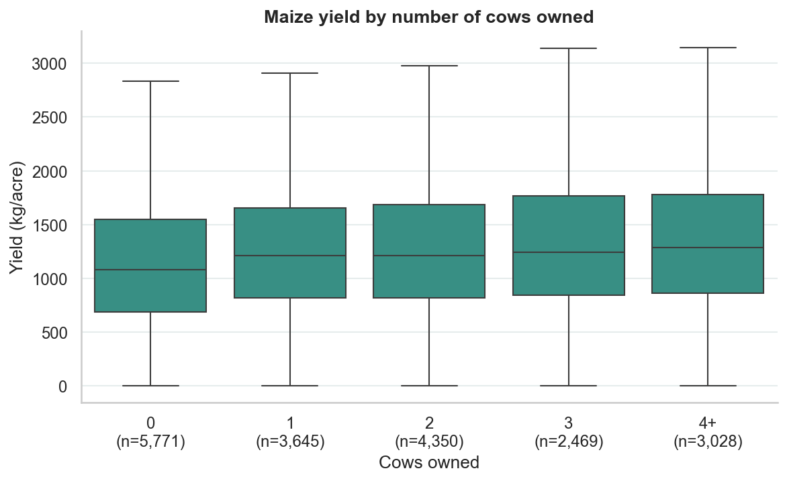

- **Intercropping:** Intercropped plots look slightly higher overall (1,206 vs. 1,144 kg/acre), but show a **0 kg/acre** median gap inside district-years (50% of 131 district-years). Intercropping does not reduce maize yield.

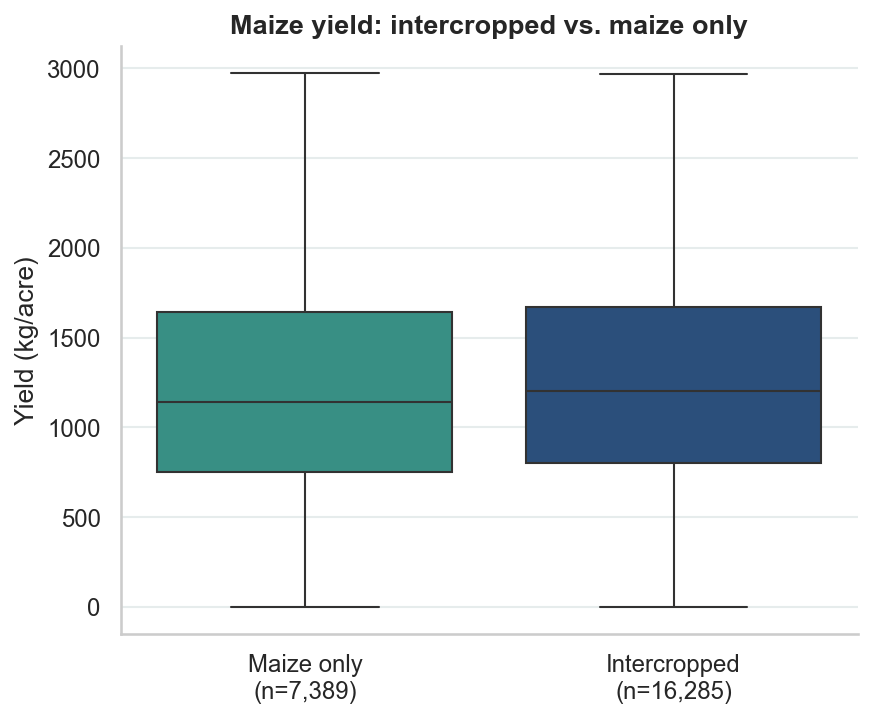

- **Lime:** Farms applying lime gain **+256 kg/acre** across 81% of 31 district-years (≥10 farms per side), though too few farms use lime for a firm conclusion.

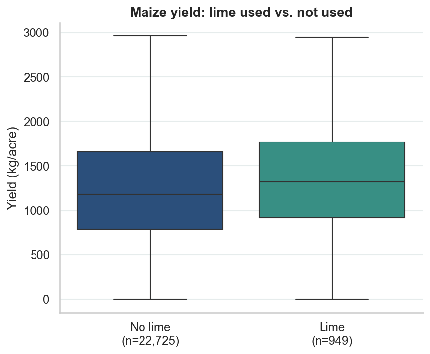

## Data cleaning decisions

- **Seed classification:** I built `seed_class` from the variety names farmers reported instead of the survey's `hybrid` flag. The `hybrid` flag disagreed with the named variety on ~1,500 farms (1,279 local-only farms flagged hybrid; 231 hybrid farms flagged non-hybrid). Those farms yield like their named variety. I excluded the 6% of farms planting a mix from the hybrid-vs-local comparison.
- **Zero yields (326 farms, 1.4%):** I kept zero yields because they represent genuine crop failures.
- **Implausible fertiliser rates:** I set DAP, CAN, and urea rates above 200 kg/acre to missing (most came from tiny plots in 2020).
- **Cow ownership:** I combined `cows` and `cows_binary` into `owns_cow` because each column covered years the other missed.

## How well these factors predict yield together

In [`modelling.ipynb`](modelling.ipynb), I tested how accurately the survey features predict yield in a new season at both the **farm level** and the **district level**. Because the models use in-season inputs and weather reports (`drought`, `flood`, fertiliser rates), they measure how well end-of-season records explain yield rather than making planting-time forecasts.

In both cases, I trained on earlier years, selected the model with the lowest mean validation MAE across **2018 and 2019**, and evaluated once on **2020**.

### Farm-level prediction

I compared Ridge regression and two `HistGradientBoostingRegressor` models across three feature sets (`existing` total fertiliser kg, `rates` per acre, and `extended` adding lime, compost, intercropping, weeding, and cow ownership). 

Validation selected **gradient boosting (`Boosting medium`) with the `extended` feature set** (mean validation MAE **512.42 kg/acre**, barely ahead of Ridge on per-acre rates at **512.71 kg/acre**).

| Model (2020 holdout, n = 6,047 farms) | MAE (kg/acre) | RMSE (kg/acre) | R² |
|---|---:|---:|---:|
| Boosting medium (`extended`) | 473.40 | 608.12 | 0.104 |
| Training median benchmark | 497.37 | 647.69 | −0.016 |
| Previous district median benchmark | 531.59 | 686.93 | −0.143 |


- **Modest lift over a simple median:** The boosting model cuts 2020 MAE by only **4.8%** compared with predicting the training-set median and explains just **10.4%** of farm-level variance (`R² = 0.104`).
- **Large local errors remain:** District error checks show MAE exceeding 640 kg/acre in Njoro (1,087.9), Imenti (812.1), Saboti (746.0), Olkalou (682.5), and Manyatta (640.0), with systematic over- and underprediction across districts. Even with seed, fertility, DAP, and weather together, most farm-to-farm variation comes from unmeasured factors.

### District-level prediction

I also aggregated the data into **180 district-years** (equal weight per district) to predict each district's mean yield from average input rates, seed/fertility/weather shares, reporting coverage, and the district's previous-year mean. Validation selected **Ridge (`alpha=100`)** (mean validation MAE **276.96 kg/acre** vs. **284.26** for the previous district mean).

| Model (2020 holdout, 50 districts) | MAE (kg/acre) | RMSE (kg/acre) | R² |
|---|---:|---:|---:|
| Ridge (`alpha=100`) | 202.22 | 275.06 | 0.213 |
| Previous overall mean benchmark | 233.52 | 310.31 | −0.001 |
| Previous district mean benchmark | 300.59 | 383.51 | −0.530 |

- **Beats district benchmarks, with caveats:** Ridge lowers 2020 district-mean MAE by **13.4%** relative to the prior year's overall mean. *(District MAE measures errors on district sample means rather than individual farms, so it is naturally smaller than farm-level MAE.)*
- **History matters, and season-to-season stability is weak:** On 2020, the 39 districts with prior-year records had **166.39 kg/acre** MAE versus **329.24 kg/acre** on the 11 districts without prior history (with large overpredictions in Imenti and Manyatta). Across validation years, Ridge's `R²` swung from **−0.297 in 2018** to **0.298 in 2019**, which limits confidence in any single future season.

## What I couldn't conclude

- **Pests (`FAW`, `striga`, `stemborer`):** Usable records cover only 2020 and farmers answered yes or no without rating severity. It's difficult to draw conclusions from the available data.
- **Urea and NPK:** Too few farmers use them (497 and 58 respectively) to support reliable comparisons.
- **Slope:** Only 19% of farms (4,447 across 2017–2020) record slope which is too sparse to make any conclusions.


## Limitations

- **Correlation, not causation:** Farmers who use hybrid seed or DAP may also have differences in capital, have different training, or plant at different times.
- **Western Kenya focus:** Most observations are from Western Kenya.
- **Self-reported measures:** Farmers self-reported drought, flood, pests, and relative field fertility. These answers could be biased
- **Uneven coverage:** District sample sizes range from under 50 to over 1,000 and shift across years.

## Run it yourself

```bash
pip install pandas numpy matplotlib seaborn scipy scikit-learn statsmodels jupyter
jupyter notebook data_visualization_updated.ipynb
```

[`data_visualization_updated.ipynb`](data_visualization_updated.ipynb) reads `data/cleaned/kenya_cleaned.csv` and saves all 25 charts to `charts/`. [`modelling.ipynb`](modelling.ipynb) runs the farm-level and district-level validation and 2020 evaluation.

